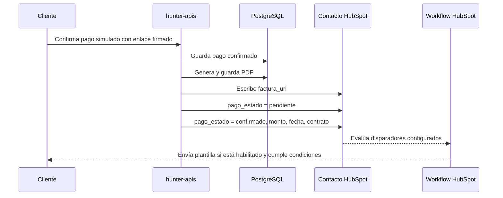

# Hunter APIs

API de las ocho herramientas de ElevenLabs. NestJS + PostgreSQL; Docker publica
el puerto 3000. Conserva las rutas, campos y respuestas en español del gateway.

| Tool | Método y ruta |
| --- | --- |
| consultar_estado_pago | POST /api/convai/pagos/estado |
| cotizar_producto_nuevo | POST /api/convai/cotizar/nuevo |
| consultar_servicios_contratados | POST /api/convai/servicios |
| cotizar_renovacion | POST /api/convai/cotizar/renovacion |
| registrar_contrato | POST /api/convai/contratos |
| generar_link_pago | POST /api/convai/pagos/link |
| escalar_asesor | POST /api/convai/crm/escalar |
| enviar_factura | POST /api/convai/factura/enviar |

No se exponen las antiguas rutas de negocio `/api/v1`, ni las tools
`imagen/enviar` y `clientes/registrar`. El gateway queda en su propio proyecto.

## Arranque

```sh
cp .env.example .env # solo en una instalación nueva; completar credenciales
docker compose up -d --build
docker compose ps
curl http://localhost:3000/health
```

Las migraciones se aplican al arrancar. La migración 002 añade `vehicle` sin
borrar contratos existentes. El volumen `hunter_apis_data` conserva los datos.

Configurar `CONVAI_API_KEY` con el mismo Bearer del agente (si falta se usa
`API_KEY`), `PUBLIC_BASE_URL` con la URL HTTPS de ngrok, y `HUBSPOT_TOKEN` con
el token del portal. No se necesitan cambios de ruta en ElevenLabs.
`LINK_SIGNING_SECRET` es opcional; si falta se usa la clave de la API.

## Cuerpos JSON

- `cotizar/nuevo`: `codigo_producto`, `marca`, `modelo`, `anio`, `ciudad`, `uso`.
  Devuelve `codigo`, `precio` sin IVA, `periodo`, `incluye_impuestos`, `servicios`.
- `servicios`: `cedula`, `placa`. Devuelve `cliente`, `servicios` con `codigo` y
  `nombre`. Consulta contratos reales; una búsqueda sin coincidencias retorna
  una lista vacía. Contratos antiguos sin vehículo no coinciden por placa.
- `cotizar/renovacion`: `cedula`, `placa`, `codigos` (array o texto separado por
  comas; `TODOS` selecciona los servicios contratados). Devuelve `items`, `total`
  con IVA. Rechaza códigos no contratados para esa cédula y placa.
- `contratos`: `nombre_completo`, `identificacion`, `correo`, `codigo_producto`,
  `vehiculo` opcional (objeto o texto), `tipo` opcional (`venta` por defecto;
  acepta `compra` y `renovación`). Devuelve `contrato_id`, `monto`.
  El teléfono se obtiene de la conversación de HubSpot que contiene la cédula;
  no se toma de un número tecleado. Reintentos con la misma cédula, producto y
  tipo reutilizan el contrato pendiente. El vehículo se guarda como JSONB.
- `pagos/link`: `contrato_id`; respaldo opcional `cedula`, `codigo_producto`.
  Devuelve `url`, `codigo`, `contrato_id`, `monto`. El respaldo solo funciona
  cuando existe un único contrato pendiente; nunca adivina por teléfono.
- `pagos/estado`: `contrato_id`. Devuelve `estado` (`pendiente`, `confirmado`,
  `rechazado`), `contrato_id`, `monto`, `fecha`, `factura_url`. Es de lectura.
- `crm/escalar`: `telefono`, `motivo` (`objecion_precio`, `indeciso`,
  `fuera_catalogo`), `contexto`. Persiste un ticket y devuelve `ok`, `ticket_id`.
  La asignación/notificación a un asesor sigue pendiente: crear el ticket no
  implica que se haya enviado un mensaje a una persona.
- `factura/enviar`: `contrato_id`, `telefono` opcional por compatibilidad.
  Genera el PDF, persiste el documento y escribe el enlace en `factura_url` de
  HubSpot usando la identidad del contrato. Devuelve `ok`, `contrato_id`, `url`,
  `factura_url`; `ok:false` indica que no se pudo escribir en HubSpot. La entrega
  al cliente depende del workflow existente en HubSpot.

Todos requieren `Authorization: Bearer <CONVAI_API_KEY>` y
`Content-Type: application/json`. Los POST correctos responden 201; validación
400, credencial ausente/incorrecta 401 y contrato inexistente 404.

## Dependencias de las tools

- `GET /health`: salud de API y PostgreSQL.
- `GET /pay/:id`: checkout **simulado**, disponible con
  `ENABLE_DEMO_CHECKOUT=true`. No hay una pasarela de cobro real integrada.
- `POST /api/pagos/webhook`: recibe la simulación aprobada/rechazada, actualiza
  el contrato y notifica al CRM. Solo funciona con el checkout de prueba activo.
- `GET /receipts/:id`: descarga el PDF.
- `POST /api/v1/crm/webhooks/conversations`: webhook de conversaciones con firma
  de HubSpot. Se mantiene como soporte, no como tool del agente.

Pago y PDF requieren los parámetros `expires` y `token` de los enlaces
firmados emitidos por la API (24 horas de vigencia). No se acepta descargar un
PDF usando únicamente un identificador adivinable. `pagos/link` y
`factura/enviar` permiten solicitar un enlace nuevo. El checkout muestra
explícitamente que no efectúa cobros reales.

Para registrar contratos desde el bot, HubSpot debe permitir leer las
conversaciones recientes y escribir contactos. Si no se identifica de forma
unívoca la conversación, la API devuelve un error y no inventa un teléfono.

## Verificación

```sh
npm ci
npm test
npm run lint
```

Las pruebas HTTP ejecutan las ocho tools con puertos en memoria y CRM simulado;
verifican el formato del agente, campos inesperados, vehículo, repetición,
consultas por placa, estado del pago, checkout, firma y PDF. No contactan
clientes ni escriben en HubSpot. Para validar los workflows reales, realizar
una conversación de prueba con el bot después de levantar Docker y ngrok.

## Alcance y separación SOLID

Este proyecto contiene una **copia adaptada** de las ocho tools del gateway.
`hunter-gateway` conserva su implementación; no se modifica ni pasa a depender
de esta API. Los dos proyectos son independientes.

- `interfaces/controllers`: valida HTTP y delega a un caso de uso por tool.
- `application/use-cases`: coordina cada operación, sin SQL, SDK de HubSpot,
  firma HMAC ni dependencia de DTOs de la capa HTTP.
- `application/ports`: interfaces específicas para búsquedas, creación
  idempotente, identidad, contacto, entrega de factura, notificación y enlaces.
- `domain`: entidades, reglas y contratos de repositorios.
- `infrastructure`: implementaciones PostgreSQL, HubSpot, firma y configuración.
- `app.module.ts`: conecta cada interfaz con su implementación mediante DI.

La creación idempotente de contratos ejecuta el bloqueo, la escritura del cliente
y la del contrato en una misma conexión y transacción PostgreSQL. La aplicación
no conoce ese mecanismo y las pruebas HTTP sustituyen los adaptadores por puertos
en memoria. Para verificar concurrencia y rollback en la base local de Docker:

```sh
docker compose exec -e TEST_POSTGRES=true api node --test dist/test/pending-contract.postgres.test.js
```

Esa prueba crea datos identificados como `SOLID-*` y los elimina al terminar.
No escribe en HubSpot ni envía mensajes.

## Por qué está organizado así

| Decisión | Motivo y consecuencia |
| --- | --- |
| Copia independiente del gateway | Permite probar y desplegar la API sin eliminar ni cambiar el código original. No existe sincronización automática entre ambos proyectos. |
| Mismas rutas y campos del agente | Evita reconfigurar las ocho tools y conserva las respuestas que interpreta ElevenLabs. |
| Un caso de uso por operación | Separa cotización, registro, cobro, factura y escalamiento para poder cambiar y probar cada responsabilidad. |
| Interfaces y adaptadores | La aplicación depende de capacidades, no de SQL ni de HubSpot. En pruebas se sustituyen esas capacidades sin contactar clientes. |
| PostgreSQL y migraciones | Los contratos, pagos y PDF sobreviven a reinicios. El volumen de Docker guarda los datos; reconstruir la imagen no los borra. |
| Transacción y bloqueo por cliente/producto/tipo | Los reintentos simultáneos reutilizan el contrato pendiente y no dejan un cliente guardado si falla la creación del contrato. |
| Precio calculado en el servidor | El importe sale del catálogo; la tool no puede fijar un precio arbitrario. |
| Identidad obtenida de la conversación | Evita asignar el contrato a un teléfono escrito por error o a un contacto identificado solo por correo. |
| Paginación de conversaciones y mensajes | La primera página de HubSpot puede contener hilos antiguos. Se recorren las páginas antes de buscar la cédula en la ventana de 30 minutos. |
| `vehiculo` como JSONB | Conserva tanto el objeto como el texto libre enviado por el agente. Solo el objeto con `placa` permite buscar servicios por placa; no se extrae la placa de texto libre. |
| PDF y enlace firmado | HubSpot recibe un enlace, no un archivo adjunto subido por la API. La firma limita el acceso y caduca a las 24 horas. |
| Envío gestionado por HubSpot | El canal, las plantillas y la entrega quedan en el CRM; la API genera documentos y actualiza propiedades. |
| Checkout explícitamente simulado | Permite comprobar el flujo sin procesar tarjetas ni realizar cobros. No equivale a una integración con una pasarela real. |

## Configuración: qué habilita cada variable

| Variable | Para qué sirve |
| --- | --- |
| `CONVAI_API_KEY` | Autentica las tools. Debe coincidir con el Bearer configurado en ElevenLabs. |
| `API_KEY` | Credencial alternativa cuando falta `CONVAI_API_KEY`; no se aceptan ambas indistintamente si la primera está configurada. |
| `PUBLIC_BASE_URL` | Dominio público con el que se construyen los enlaces de pago y PDF. HubSpot y el cliente deben poder acceder a él. |
| `LINK_SIGNING_SECRET` | Firma los enlaces; si está vacío usa `CONVAI_API_KEY` o `API_KEY`. Cambiar la clave invalida enlaces anteriores. |
| `ENABLE_DEMO_CHECKOUT` | `true` habilita la página y confirmación de pagos simulados. No activa un workflow de HubSpot. |
| `HUBSPOT_TOKEN` | Autentica las consultas y escrituras del CRM. La app privada necesita leer conversaciones y leer/escribir contactos (`conversations.read`, `crm.objects.contacts.read`, `crm.objects.contacts.write`). |
| `HUBSPOT_PAGO_PROPERTY` | Nombre interno alternativo para `pago_estado`. Si se cambia, los disparadores del workflow deben usar la misma propiedad. Es opcional, aunque no figure en `.env.example`. |
| `HUBSPOT_CLIENT_SECRET` | Valida la firma del webhook de conversaciones entrante; no es el token utilizado para escribir contactos. |
| `HUBSPOT_PORTAL_ID` | Filtra eventos del webhook para el portal esperado. |
| `HUNTER_WHATSAPP_NUMBER` | Número del botón de retorno a WhatsApp del checkout. Es opcional; sin él el botón no abre un chat configurado. |
| `DB_HOST`, `DB_PORT`, `DB_USER`, `DB_PASSWORD`, `DB_NAME` | Conexión a PostgreSQL. Compose sustituye host y puerto por los de su red interna. |
| `DB_SSL`, `DB_SSL_REJECT_UNAUTHORIZED`, `DB_TRUSTED_NETWORK` | Distinguen conexiones TLS de la red privada de Compose. No confundir el puerto local de la base con el puerto dentro del contenedor. |
| `DB_POOL_*`, `DB_*TIMEOUT_MS` | Limitan conexiones y esperas para que una consulta bloqueada no retenga recursos indefinidamente. |
| `RATE_LIMIT_TTL_MS`, `RATE_LIMIT_MAX` | Limitan peticiones por IP. Una respuesta 429 corresponde a ese límite. |
| `CORS_ORIGINS` | Orígenes permitidos para llamadas desde navegadores; no sustituye al Bearer de las tools. |

Después de editar `.env`, ejecutar `docker compose up -d --force-recreate api`.
Un simple reinicio del proceso no incorpora cambios al entorno del contenedor.
No subir `.env` a Git; `.env.example` documenta la configuración sin credenciales.

## Factura y pago: quién hace cada paso



| Acción | Responsable en código | Efecto en HubSpot |
| --- | --- | --- |
| Registrar contrato | `RegisterToolContractUseCase` → `HubSpotService.markOptInAndContract()` | Escribe `contrato_id` y `whatsapp_optin_requested=true`; también intenta actualizar el correo. |
| Confirmar pago | `ProcessDemoPaymentUseCase` → `HubSpotService.notificarPago()` | Intenta escribir `factura_url`, luego pasa `pago_estado` por `pendiente` y finalmente `confirmado`, junto con monto, fecha y contrato. |
| Rechazar pago | Mismo caso de uso y adaptador | Actualiza el estado a `rechazado`; no genera una factura nueva. |
| Llamar a `enviar_factura` | `SendToolInvoiceUseCase` → `HubSpotService.setFacturaUrl()` | Genera o reutiliza el PDF y escribe un enlace firmado en `factura_url`. No cambia `pago_estado`. |
| Consultar estado o generar link | `QueryPaymentStatusUseCase` / `GeneratePaymentLinkUseCase` | No escriben propiedades ni disparan notificaciones. |

No hay una llamada a «ejecutar workflow» ni un ID de workflow en la configuración.
El disparo es indirecto: HubSpot observa las propiedades que cambia la API.
Tener `HUBSPOT_TOKEN` configurado habilita los intentos de escritura, pero no crea,
publica ni habilita workflows en el portal.

`factura/enviar` devuelve `ok:true` cuando HubSpot acepta la escritura del enlace;
no confirma que WhatsApp haya entregado el mensaje. El PDF actual es un comprobante
de contrato, sin firma electrónica ni autorización tributaria.

## Preparar las propiedades del contacto en HubSpot

Usar estos **nombres internos**, no solo etiquetas visualmente parecidas.
La API no crea las propiedades personalizadas automáticamente.

| Nombre interno | Tipo esperado por esta integración | Uso |
| --- | --- | --- |
| `contrato_id` | Texto de una línea | Vincula el pago al contacto. |
| `pago_estado` | Texto o enumeración con valores internos `pendiente`, `confirmado`, `rechazado` | Disparador de confirmación/rechazo. |
| `pago_monto` | Número | Importe que muestra la plantilla. |
| `pago_fecha` | Texto de una línea | Recibe una fecha formateada como texto, no un timestamp de propiedad fecha. |
| `factura_url` | Texto de una línea | Enlace HTTPS completo al PDF, incluidos `expires` y `token`. |
| `whatsapp_optin_requested` | Casilla booleana | Solicitud interna de procesamiento de la suscripción. |
| `whatsapp_optin_aplicado` | Casilla booleana | Señal que puede escribir el workflow de suscripción al finalizar. |
| `phone`, `mobilephone`, `hs_whatsapp_phone_number`, `email` | Propiedades del contacto existentes | Identidad, destinatario y datos de contacto. |

La notificación del pago busca primero el contacto por `contrato_id` y después
usa el contacto por teléfono que tenga en caché. Si no lo encuentra, registra
`PAGO SIN CONTACTO` y no envía la notificación. El contrato puede permanecer pagado
en PostgreSQL aunque el CRM no haya sido actualizado.

## Cómo activar los workflows

Esta es la configuración que necesita la integración; **no certifica que el
workflow de un portal concreto esté publicado o funcionando**. Los nombres de
workflow siguientes son descriptivos y no están codificados en el servicio.

### 1. Confirmación de pago

1. En HubSpot, abrir **Automatización → Workflows** y crear o editar un workflow
   basado en contactos.
2. Configurar inscripción cuando `pago_estado` sea `confirmado`. Si se utiliza
   `HUBSPOT_PAGO_PROPERTY`, elegir esa propiedad en su lugar.
3. Habilitar la reinscripción correspondiente a ese estado para pagos posteriores
   del mismo contacto. El paso `pendiente → confirmado` del servicio intenta
   volver a cumplir la condición; no reemplaza la configuración de reinscripción.
4. Añadir la acción de envío de WhatsApp con la plantilla aprobada del portal y
   mapear sus variables a `contrato_id`, `pago_monto` y `pago_fecha`. Si incluye el
   documento, usar `factura_url` completa.
5. Revisar y publicar/activar el workflow. Para la primera prueba, evitar inscribir
   de golpe todos los contactos históricos que ya estén en `confirmado`.

La publicación y la selección de registros existentes se describen en la
[guía oficial de creación de workflows](https://knowledge.hubspot.com/workflows/create-workflows).
La reinscripción debe revisarse por separado: un registro no vuelve a entrar
mientras aún está dentro del mismo workflow. Ver
[reinscripción de workflows](https://knowledge.hubspot.com/workflows/add-re-enrollment-triggers-to-a-workflow).

### 2. Entrega de factura

Para que **la tool `enviar_factura` también funcione por sí sola**, el envío del
documento debe reaccionar a la actualización de `factura_url`, porque esa tool
no cambia el estado del pago.

1. Crear o editar un workflow de contactos con el disparador de actualización de
   `factura_url`, o el criterio «es conocida» con la reinscripción adecuada a los
   cambios de esa propiedad. Verificar con un contacto de prueba que una URL nueva
   permite una nueva ejecución.
2. Antes del envío, comprobar que la URL no esté vacía. Si el negocio solo permite
   entregar documentos pagados, añadir la condición `pago_estado=confirmado` y
   contemplar que la API escribe la URL **antes** del cambio final de estado: una
   rama que simplemente descarte al contacto mientras sigue pendiente perdería
   ese primer envío. Configurar la espera/reevaluación correspondiente.
3. Añadir la acción de WhatsApp y usar `factura_url` como variable de la plantilla
   aprobada disponible en el portal. Enviar el enlace completo; no quitar los
   parámetros de firma.
4. Publicar el workflow y verificar la inscripción y ejecución de la acción.

Para evitar duplicar la factura, definir un solo workflow como responsable de
entregar el documento. Una configuración posible es: confirmación de pago envía
solo el aviso; entrega de factura envía el enlace. Al confirmar un pago la API
actualiza ambas propiedades y puede activar ambos workflows.

El canal debe estar conectado, la plantilla disponible y el contacto debe tener
consentimiento de WhatsApp. Consultar la
[documentación oficial de plantillas y uso en workflows](https://knowledge.hubspot.com/templates/use-whatsapp-message-templates-in-hubspot).
La acción concreta disponible depende de la suscripción y configuración del portal.

### 3. Suscripción y rechazo

El registro marca `whatsapp_optin_requested=true`. Esa propiedad personalizada
**no equivale a una suscripción nativa de WhatsApp ni demuestra consentimiento**.
Si se utiliza un workflow de suscripción, debe procesar el consentimiento válido,
gestionar la suscripción correspondiente y, cuando proceda, escribir
`whatsapp_optin_aplicado=true`. No volver a suscribir automáticamente a quien se
dio de baja. El flujo actual de `pagos/link` no espera a que esa señal esté aplicada.

Para notificar rechazos, configurar otro workflow o rama con
`pago_estado=rechazado`, su plantilla y reinscripción. Rechazar no debe utilizarse
como disparador de entrega de factura.

## Prueba de extremo a extremo y diagnóstico

1. Confirmar que `docker compose ps` muestra la API activa y la base saludable,
   y que `/health` devuelve `database: "ok"`.
2. Usar una conversación de prueba en HubSpot con cédula y correo, registrar el
   contrato y comprobar que el contacto tiene su `contrato_id`.
3. Generar el enlace y confirmar el pago simulado. Comprobar el estado local con
   `consultar_estado_pago`.
4. Revisar en el contacto el historial de `factura_url`, `pago_estado`,
   `pago_monto`, `pago_fecha` y `contrato_id`.
5. Revisar el historial de inscripción y el resultado de la acción de WhatsApp
   de cada workflow. Finalmente, comprobar que el destinatario recibió el mensaje
   y puede abrir el PDF antes de que venza el enlace.
6. Para verificar la tool independiente, llamar a `enviar_factura` con el contrato
   de prueba y repetir la comprobación de la propiedad y del workflow de factura.
   Esta prueba puede enviar un mensaje real mediante HubSpot.

Para ver los registros del servicio:

```sh
docker compose logs --since 15m api
```

| Síntoma | Qué revisar y por qué |
| --- | --- |
| `No pude identificar la conversación` | Conversación dentro de la ventana de 30 minutos, cédula presente en mensajes, teléfono del remitente y permisos de lectura. La búsqueda debe recorrer todas las páginas. |
| `factura/enviar` responde `ok:false` | Token, permisos y existencia de `factura_url`; el PDF puede existir aunque falle su publicación en el contacto. |
| `PROPERTY_DOESNT_EXIST` | Crear o corregir la propiedad con el nombre interno indicado. |
| `PAGO SIN CONTACTO` | Asociación `contrato_id` del contacto; no es un fallo del almacenamiento del pago. |
| Propiedades cambian pero no llega WhatsApp | Workflow publicado, disparadores, reinscripción, historial de acciones, plantilla y suscripción del destinatario. |
| Solo se envía el primer pago | Reinscripción y si el contacto sigue dentro de una ejecución previa. El doble PATCH por sí solo no garantiza una nueva inscripción. |
| PDF inaccesible | Dominio público activo y parámetros de firma completos; el enlace vence a las 24 horas. Solicitar uno nuevo mediante la tool. |
| Dos facturas por un pago | Dos workflows o acciones están entregando el mismo documento. Elegir un responsable. |

Los avisos a HubSpot son de mejor esfuerzo y no tienen una cola persistente de
reintentos. Repetir un pago ya confirmado devuelve `already:true` y **no vuelve a
notificar al CRM**. Además, si falla la generación del PDF después de guardar el
pago, el estado puede quedar confirmado sin que se complete la notificación.
Investigar el fallo y recuperar el paso pendiente; no asumir que reabrir o volver
a pulsar el checkout repara la entrega. `enviar_factura` permite reintentar la
publicación de la URL, pero no reconstruye las propiedades del aviso de pago.

## Orden de ejecución y dependencias del agente

[docs/api-flow.json](docs/api-flow.json) documenta las ocho tools, su orden por
flujo, los campos requeridos, el origen de cada dato y las respuestas que deben
conservarse para la siguiente llamada. Incluye venta, renovación por producto,
pago simulado, seguimiento, factura, consentimiento y escalamiento.

Es un JSON documental, no un ejecutor ni una colección de Postman. Las referencias
`state.*` y `response.*` describen valores que debe conservar y sustituir el
orquestador. No se envían literalmente como datos del cliente.

La sección `diferencias_prompt_api` identifica las instrucciones que aún no
coinciden con la implementación: `registrar_cliente` ausente, motivo
`fallo_cotizacion` no admitido, catálogo diferente, checkout en español y
transferencia humana/entrega WhatsApp no garantizadas por la API. Documentarlas
no modifica ni habilita esos comportamientos.
